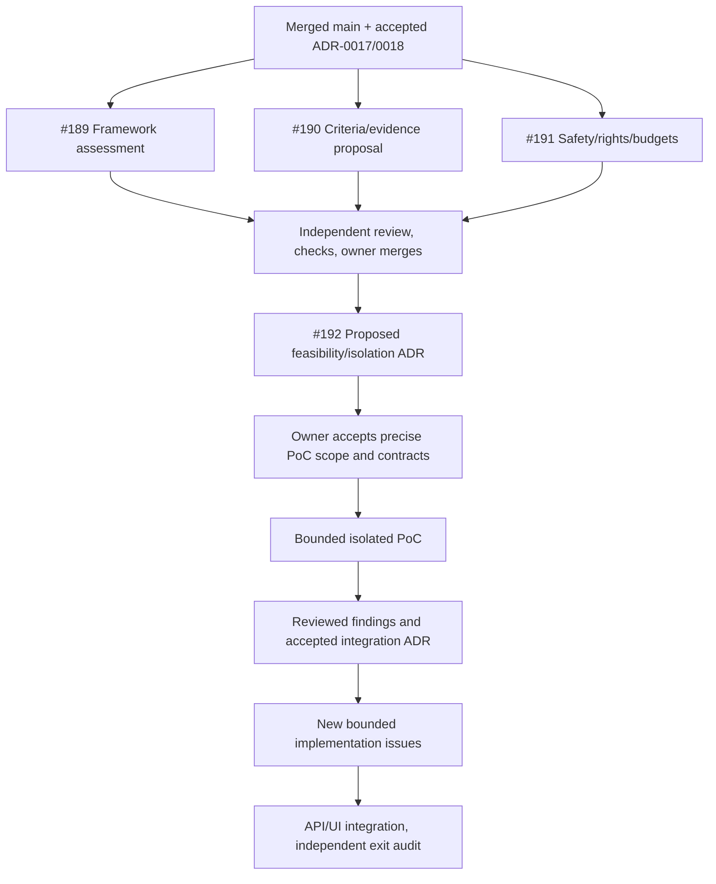

# M10 — AI Research Agents: parallel feasibility plan

## Authorization and first delivery

On 2026-10-18 the owner requested starting Milestone 10 in a manner that lets
multiple agents work on different issues concurrently. This starts the bounded
static/offline feasibility and contract assessments below. It does not accept
the remaining proposed production requirements or select a framework from the
Taurus product label. [SRS §23.10](../../SRS.md#milestone-10--ai-research-agents)
and accepted [ADR-0017](../adr/0017-user-criteria-taurus-discovery.md) and
[ADR-0018](../adr/0018-custom-criteria-editor.md) govern the work.

The attached master-agent document supplies a coordination pattern. Its stale
Milestone 2 placeholder is not the requested milestone, and its conditional
approval/merge language does not override AGENTS.md's prohibition on agent
merges. Each issue receives one isolated branch/worktree and one reviewable PR.

Parent: [M10 — AI Research Agents](https://github.com/daniilnahl/Stock-Tracking-App/milestone/11).
GitHub's numeric milestone ID is **11**; milestone **10** is the M9 container.
Planning is [#188](https://github.com/daniilnahl/Stock-Tracking-App/issues/188).

## Verified starting point

All worktrees start at main
`3b3df5b2f43f1f8df00f88b76714385a865516be`, the owner merge of
[#187](https://github.com/daniilnahl/Stock-Tracking-App/pull/187).
[Main Foundation 39151805497](https://github.com/daniilnahl/Stock-Tracking-App/actions/runs/39151805497)
completed successfully, verified directly on 2026-10-18. The criteria editor,
upcoming-EPS dashboard and M9 accepted-scope audit are present on this baseline.
The M9 delivery issues #164/166/168/170/172/174/176/178/180/182/184/186 are closed
as completed on the current GitHub snapshot. The M9 milestone container remains
administratively open; that is separate from accepted runtime delivery.

Earlier pending-merge statements in dated M9 records describe their historical
snapshots. They do not authorize broader research or imply current missing
runtime work. [Current implementation status](../CURRENT_STATUS.md) separates
delivered behavior from the proposed roadmap.

## Stable inputs and shared boundaries

Agents consume merged files without changing them:

- AGENTS.md, SRS.md, docs/TESTING.md and relevant accepted ADRs.
- ADR-0018's exact version-1 prepared criteria envelope and
  `frontend/src/features/criteria.ts`, with its existing unit/component/browser
  tests. Preserve ordered duplicate rows, explicit all/any, range/text types,
  decimal strings/null and unit/context. These are descriptions, not metric
  definitions, qualified results or instructions to a model/tool.
- Existing financial definitions and EPS limitations. No new return, EPS,
  threshold, sector, identity, historical cutoff or ranking convention is
  invented to make the assessment appear complete.
- Existing core dependency pins, API/authentication, holdings and tab-memory
  criteria behavior. Existing local API guards are not proof of worker isolation.

Each assessment has a single focused session of at most 45 minutes. At the
boundary, record findings and unknowns rather than expanding scope. Public
primary-source metadata/source review is allowed; no upstream installation or
execution, model/provider request, paid run, scraping, private-data transmission
or credential access is part of the assessment. Recreating the unchanged
canonical application development environment for repository checks is separate
from installing a candidate framework.

## Issue ownership and live status

| Issue | Agent | Exclusive file ownership | Branch | Status / dependency | PR / review |
| --- | --- | --- | --- | --- | --- |
| [#188](https://github.com/daniilnahl/Stock-Tracking-App/issues/188) Parallel plan | Master | This plan; minimal SRS/current-status pointers; GitHub planning metadata | `codex/m10-parallel-feasibility` | Reviewed; no blocker | This planning change; owner merge remains separate |
| [#189](https://github.com/daniilnahl/Stock-Tracking-App/issues/189) Framework feasibility | `m10_framework` | `docs/milestones/m10-framework-feasibility.md` | `codex/189-m10-framework` | Assessment published; owner merge pending | [#195](https://github.com/daniilnahl/Stock-Tracking-App/pull/195); local checks and independent review passed; live CI on PR |
| [#190](https://github.com/daniilnahl/Stock-Tracking-App/issues/190) Criteria/evidence proposal | `m10_contract_review` | `docs/milestones/m10-criteria-evidence.md` | `codex/190-m10-criteria` | Assessment published; owner merge pending | [#193](https://github.com/daniilnahl/Stock-Tracking-App/pull/193); local checks and independent review passed; live CI on PR |
| [#191](https://github.com/daniilnahl/Stock-Tracking-App/issues/191) Safety/rights/budgets | `m10_safety` | `docs/milestones/m10-safety-assessment.md` | `codex/191-m10-safety` | Assessment published; owner merge pending | [#194](https://github.com/daniilnahl/Stock-Tracking-App/pull/194); local checks and independent review passed; live CI on PR |
| [#192](https://github.com/daniilnahl/Stock-Tracking-App/issues/192) Proposed feasibility/isolation ADR | Unassigned until ready | `docs/adr/0019-m10-feasibility-isolation.md`, then approved minimal status links | Assign at start | **Blocked** by #189/#190/#191 owner merges and required CI | Not started |

The three assessment worktrees are separate sibling checkouts outside the
repository source tree, under this chat's task-local workspace. They share a
read-only baseline, not an index or working files. Master owns shared planning
documents and issue metadata; agents do not edit one another's reports or the
plan. A review correction goes back to the owning agent. No agent independently
redesigns the criteria envelope or publishes a new public contract.

## Parallel execution and dependency graph

#188 coordinates independently and does not block source assessments. #189,
#190 and #191 may run together because none consumes another unmerged output.
They produce proposals rather than executable interfaces. GitHub also records
native blocked-by relationships from #192 to all three assessment issues.
#192 may not start
from an agent's promise or an open PR; its merge/CI blockers are explicit.

After accepted findings stabilize the interfaces, plan independently owned
adapter, criteria/evidence validation and budget/lifecycle implementation issues.
Only then schedule composition, API/UI and independent adversarial/core-fallback
audit. Do not create speculative full-roadmap implementation tasks now. If a
shared interface must change, stop its downstream work until one reviewed
contract is stable. Do not merge PRs on the owner's behalf.

## Review and verification

For each assessment PR, review actual source references and distinguish
inspected facts, proposed design, unverified runtime behavior and owner/vendor
decisions. In particular, source availability is not data transmission rights;
schema-valid criteria are not verified matches; a disabled upstream trader
label is not proof of read-only confinement; citations must support claims.

Use supported Python 3.11/3.12 and unchanged `pip install ".[dev]"` pins.
Run canonical full pytest, Ruff, configured mypy (`config.py` only), pip check,
staged hygiene and changed Markdown target/diff checks before publication.
Serialize heavy Python/browser verification across worktrees; no frontend
build/browser profile is required for these documentation-only changes.
Independent review and exact-head CI are recorded on each PR. Passing checks
do not accept the proposed production contracts or close the milestone.

Executed locally in the unchanged canonical Python 3.12.10 environment: full
pytest passed **3,178 tests in each of the four worktrees** (plan 222.54s,
criteria 210.39s, safety 210.78s, framework 211.66s). Ruff, configured mypy,
pip check, staged hygiene (nine tests per worktree), changed local Markdown
targets and diff checks passed. Verification used task-local temporary state
and blank provider credentials. The Master plan was independently reviewed by
the criteria agent; criteria by the safety agent; safety by the framework
agent; and framework by the criteria agent, including independently fetched
pinned source spot-checks. Master reviewed each assessment. The criteria report
was clarified so that `any` cannot bypass candidate identity/core/mandatory
evidence gates. No remaining actionable review finding was identified. These
are repository regression results, not proof of future AI execution controls.

## Completion and next decision

This first phase is delivered when the three bounded assessments and plan have
reviewed PRs with honest verification and no overlap. Owner merges and #192's
subsequent proposed ADR remain separate gates. Before any upstream PoC, present
the concrete candidate/version, execution environment, permitted actions/data,
hard bounds, stop conditions and unresolved rights/cost/privacy questions for
owner review. No extra approval is requested for the assessments themselves.

M10 remains incomplete until its separately accepted production scope, required
issue closure, owner merges, CI and independent exit criteria are satisfied.
No Taurus search, candidate result, model call or new financial behavior is
delivered by this plan.
