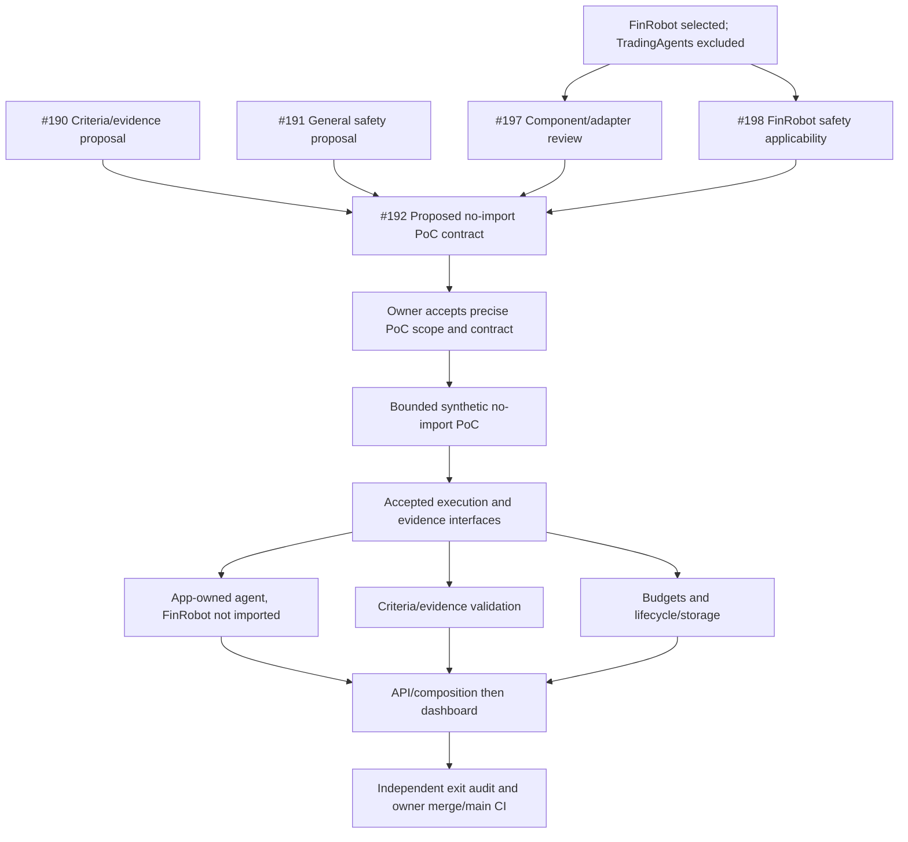
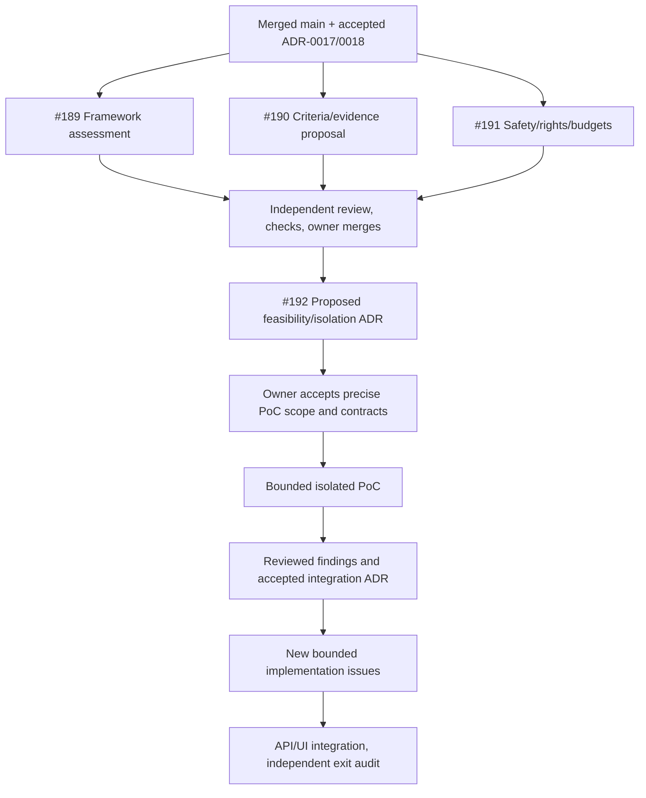

# M10 — FinRobot integration: revised scope and parallel plan

## Current owner decision — 2026-10-19

The owner accepted [ADR-0020](../adr/0020-m10-owner-decisions.md) on 2026-10-19.
Where the 2026-10-18 paragraphs below differ, that ADR and the amended SRS
control. The 2026-10-18 text stays as history, including the holdings, opinion,
and open-D9 sentences in [m10-finrobot-safety.md](m10-finrobot-safety.md).
The #197 charter in [m10-finrobot-feasibility.md](m10-finrobot-feasibility.md)
also stays historical. Phase B of that charter is retired.

- Costs: hard per-run and per-day caps in dollars. The owner sets the amounts
  in configuration. No numeric default is stated here. A run reserves its full
  estimated maximum cost before any billable call. On an in-flight cancel, the
  whole reservation is kept and released only after the provider's reported
  usage confirms the real charge. The zero-cost synthetic mode ships first.
  Billable providers stay disabled until the caps are configured.
- Holdings: agents may read holdings locally. Holdings are never sent to any
  LLM provider. The agent-visible projection is tickers and portfolio weights
  only, with no quantities, cost basis, or account data. X716 is unchanged.
- Opinion text: allowed only when labeled "Research opinion, not financial
  advice", and only in research output and the stock suggestion of the day.
  Verdicts are Buy, Hold, or Avoid plus a reason. No numeric price targets and
  no forecasts.
- Stock suggestion of the day: one per day, picked deterministically from the
  user's watchlist using existing factual criteria the application already
  computes. The agent only writes the explanation. No new ranking metric. This
  resolves D7 for this feature only.
- Run status: `pending`, `running`, `completed`, `completed_empty`, `partial`,
  `failed`, `cancelled`, `disabled`. No candidates found is `completed_empty`.
- Licensing: evidence comes only from the user's own FMP and Finnhub data under
  those providers' existing terms. Reports are retained locally only.
- Settlement: a run is settled only when the provider's usage report matches or
  is within the reservation. A finished local task or a missing usage payload
  is not settled.
- #197 Phase B, which loads FinRobot V2 code, is retired in favor of the #199
  no-import rule. Its numeric charter figures are not defaults.

Mismatches M-01 through M-07 from the #201 review are resolved by these
decisions. The checklist file on #203 is not edited from the branch that
records this plan update.

## Current owner decision — 2026-10-18

The owner's decision of 2026-10-18 excluded TauricResearch/TradingAgents, then
explicitly selected
[AI4Finance-Foundation/FinRobot](https://github.com/AI4Finance-Foundation/FinRobot)
as the agent workflow. M10 therefore retains agent-enabled research integration;
it is not infrastructure-only and does not substitute an invented agent stack.
Taurus remains the existing product label. The exact FinRobot generation,
revision, entry point, allowed workflow and execution contract still need review.
Framework selection does not accept upstream defaults, new financial formulas,
source/model rights, paid runs or a replacement toolchain.

This supersedes the TradingAgents-specific integration path and its mandatory
dependency on #189/#195. That
[TradingAgents report](m10-tradingagents-feasibility.md) remains historical decision evidence;
merging it is not a prerequisite for FinRobot. The earlier assessment-phase
record below is preserved as history, including its original dependency graph,
PR heads and test results; it is not the current execution graph.

## What remains of M10

| Area | Already available / reusable | Remaining bounded work |
| --- | --- | --- |
| Criteria | ADR-0018 tab-memory editor and exact immutable prepared envelope | Revalidate backend handoff; bind snapshot to a run; resolve supported meanings without altering user input. #190/#193 is a reviewed proposal, not an implemented receiver. |
| FinRobot execution | Framework direction selected; preliminary static source review only. Owner policy of 2026-10-18: do not import FinRobot code; the pin is a reference design. ADR-0020 retires #197 Phase B. | Build agents in this application without loading that package. The zero-cost synthetic mode ships first. Reopening an import needs a new owner decision. Phase B's numeric charter figures are not defaults. No M10 runtime exists yet. |
| Data and discovery | Existing FMP current/history and explicit Finnhub EPS capabilities | Define permitted universe and discovery tools; map identities, dates/units and evidence. Ticker research does not establish criteria-driven discovery. Existing EPS unknowns still prevent unsupported comparisons. |
| Evidence/results | #190/#193 proposed qualification and source-support rules | Implement captured provenance, exact criterion association, candidate prerequisites, missing/conflicting evidence, and validated reports. No candidates found is `completed_empty`, distinct from `partial`, `failed`, and `disabled`. |
| Safety/budgets | Existing API access/admission, #191/#194 general proposal, and the recorded [FinRobot surface map](m10-finrobot-safety.md) | Apply the map without importing FinRobot. Isolate credentials, files, and network; sanitize diagnostics. Dollar caps, the full pre-call reservation, settlement, the local ticker-and-weight projection, and the labeled opinion are the 2026-10-19 rules in ADR-0020. Billable providers stay disabled until the owner sets the caps. The map is not an implemented sandbox. |
| Lifecycle/storage | Core SQLite holdings and history cache | Separately reviewed research run/report storage using the AI1015 status list, plus dedup, recovery, retention, and user-owned-report rules. Reports are retained locally only. Core storage is not an existing research store. |
| API/dashboard | Authenticated local API and packaged dashboard | Add accepted versioned research routes and opt-in composition, then run/candidate/progress/source/cost views in the existing dashboard. Preserve core workflows and disabled-mode independence. |
| Verification/release | Existing deterministic core tests and source/wheel profiles | No-import agent, evidence, injection, budget/cancellation, absent-AI and actual composition checks; independent audit, owner merges and main CI against accepted revised exit criteria. |

Owner decision, 2026-10-18, for the safety and budget row: the M10 agent sandbox
is Linux-only. On Windows it runs through WSL or Docker. Native Windows
sandboxing is not required. #191/#194 and #198 apply isolation controls on that
Linux deployment.

TradingAgents installation/pin resolution, graph pruning, memory/auth/checkpoint
adaptation and its component-specific notices are removed from M10 work. Its
four dependency conflicts are not FinRobot findings. Trading, autonomous holdings
changes, upstream valuation/backtest formulas, paid sources, hosted release and
unrelated browser holdings mutations stay under their existing separate gates.
Selecting FinRobot does not add them. Opinion text for research output and a
stock suggestion of the day is the 2026-10-18 owner decision recorded in the
safety map. That allowance did not set a ranking formula, a cadence, or a
financial calculation, and it does not authorize a trade. ADR-0020 now sets
the suggestion-of-the-day rule for that feature only and narrows the opinion
text.

Owner decisions of 2026-10-18, recorded from the owner's answers on
[#199](https://github.com/daniilnahl/Stock-Tracking-App/pull/199) in
[m10-finrobot-safety.md](m10-finrobot-safety.md). These are policy, not
enforcement. M10 agents are built without importing FinRobot code. This
paragraph's grant let agents see stored holdings, with credentials and secrets
excluded. ADR-0020 replaces that field list with tickers and portfolio weights
only, and it supersedes the open D9 status in the next sentence. D9 pricing
and uncertain in-flight charges on cancellation stay open in this 2026-10-18
paragraph.

## FinRobot preliminary review and unresolved fit

Source inspected at commit
[`2717499b8e30f242640af08c4ad9afd1113c2d45`](https://github.com/AI4Finance-Foundation/FinRobot/commit/2717499b8e30f242640af08c4ad9afd1113c2d45).
This is a source-review pin, not an accepted installation/artifact pin.
The tool, credential, egress, budget, and cancellation map for that pin is
[m10-finrobot-safety.md](m10-finrobot-safety.md). The bullets below stay the
planning sketch; they are not a second enforcement contract.

- FinRobot contains V0 AutoGen, V1 equity and V2 desktop/backend generations.
  Pinned root [setup.py](https://github.com/AI4Finance-Foundation/FinRobot/blob/2717499b8e30f242640af08c4ad9afd1113c2d45/setup.py)
  installs V0 under the import name `finrobot` and also installs
  `finrobot_equity` (V1). V2's package is also named `finrobot`
  ([V2 manifest](https://github.com/AI4Finance-Foundation/FinRobot/blob/2717499b8e30f242640af08c4ad9afd1113c2d45/finrobot_desktop/pyproject.toml)),
  so the two clash on that name. Root installation does not install the V2 backend.
- The pinned root [NOTICE](https://github.com/AI4Finance-Foundation/FinRobot/blob/2717499b8e30f242640af08c4ad9afd1113c2d45/NOTICE)
  is part of the SRS AI1026 license review. It identifies Apache-2.0 and states
  that "FinRobot" and "AI4Finance" are trademarks of AI4Finance Foundation, that
  use of the FinRobot name, logo, or brand on a derivative product, service, or
  distribution must follow the FinRobot Trademark Policy, and that redistributions
  must retain the NOTICE. Component, dependency, and data/model obligations remain
  for #197. Nothing was copied or installed.
- V0 declares Python `>=3.10,<3.12` and incompatible NumPy/Starlette/
  typing_extensions pins; V1 requires NumPy below 2. V2 declares Python `>=3.11`
  and its shared direct FastAPI/Uvicorn/Click/Matplotlib ranges allow the core
  pins. This does not prove transitive resolution or supported-runtime behavior.
  [V0 requirements](https://github.com/AI4Finance-Foundation/FinRobot/blob/2717499b8e30f242640af08c4ad9afd1113c2d45/finrobot_autogen/requirements.txt),
  [V1 requirements](https://github.com/AI4Finance-Foundation/FinRobot/blob/2717499b8e30f242640af08c4ad9afd1113c2d45/finrobot_equity/requirements.txt).
- The inspected V2 [SDK](https://github.com/AI4Finance-Foundation/FinRobot/blob/2717499b8e30f242640af08c4ad9afd1113c2d45/finrobot_desktop/finrobot/sdk.py)
  exposes ticker research/valuation/Q&A/backtesting. It does not establish an
  ADR-0018 receiver or compliant criteria/universe discovery. Its deterministic
  valuation operators are not approved application financial definitions.
- V2 registers broader acquisition/backtest tools and stores settings/artifacts;
  default calls/retries do not establish this app's hard spend/cancellation
  contract. Inspect the [orchestrator](https://github.com/AI4Finance-Foundation/FinRobot/blob/2717499b8e30f242640af08c4ad9afd1113c2d45/finrobot_desktop/finrobot/engine/orchestrator.py),
  [runner](https://github.com/AI4Finance-Foundation/FinRobot/blob/2717499b8e30f242640af08c4ad9afd1113c2d45/finrobot_desktop/finrobot/engine/pipelines/runner.py)
  and [executor](https://github.com/AI4Finance-Foundation/FinRobot/blob/2717499b8e30f242640af08c4ad9afd1113c2d45/finrobot_desktop/finrobot/engine/pipelines/protocols.py).

An earlier sketch recommended reviewing a minimal V2 Python backend subset
behind an adapter while retaining this app's UI, authentication, and core pins.
The owner's 2026-10-18 decision supersedes that sketch for execution: do not
import FinRobot code. The inspection notes stay reference material. Neither
the full desktop/server stack nor a default research pipeline is accepted.
No upstream package, runtime, code, model or provider was executed in this review.

## Current issue ownership and dependency order

| Issue | Exclusive ownership | State / dependencies |
| --- | --- | --- |
| #188 / [#196](https://github.com/daniilnahl/Stock-Tracking-App/pull/196) | Master: plan, SRS, ownership/status pointers and issue metadata | Scope revised in this existing planning PR; owner merge remains separate. Earlier verification below is dated, not this revision's check result. |
| [#197](https://github.com/daniilnahl/Stock-Tracking-App/issues/197) | `docs/milestones/m10-finrobot-feasibility.md` | Historical static review. ADR-0020 retires Phase B. Its numeric charter figures are not defaults. |
| [#198](https://github.com/daniilnahl/Stock-Tracking-App/issues/198) | `docs/milestones/m10-finrobot-safety.md` | Recorded as a proposal in [m10-finrobot-safety.md](m10-finrobot-safety.md). Parallel with #197. Not an accepted runtime contract. |
| #190/#193 and #191/#194 | Existing criteria/evidence and general-safety proposal owners | Reuse reviewed findings; owner merges/acceptance remain gates. No duplicate criteria redesign. |
| [#192](https://github.com/daniilnahl/Stock-Tracking-App/issues/192) | `docs/adr/0019-m10-feasibility-isolation.md` and approved minimal links | Define the no-import PoC contract after #190/#191/#197/#198 required delivery. ADR-0020 is a separate owner-decision record and does not occupy 0019. Importing FinRobot code needs a new owner decision. #189 is removed as a mandatory blocker. |
| #189/#195 | Historical TradingAgents assessment | Excluded framework; optional decision evidence, not required FinRobot delivery. |

Each new issue receives its own branch/worktree/PR when implementation starts.
#197 and #198 may proceed together because both inspect stable source and write
different reports. They must not invent a shared runtime interface independently.

The remaining M10 goal is an explicitly initiated, bounded FinRobot-backed
criteria search with honest candidate evidence/status, optional approved research
and preserved tracker use when AI is disabled. Exact generation/workflow, supported
universe/metrics and execution limits still need concrete accepted contracts
outside the 2026-10-19 decisions. Dollar caps are owner-configured and unset.
Billable providers stay disabled. Evidence is limited to the user's own FMP
and Finnhub data, with reports retained locally only. No new billable/live run
is authorized here.

## Historical initial assessment phase

The following sections record the earlier TradingAgents candidate assessment
phase. The current owner decision and dependency table above supersede its
component selection and blocker graph; historical results are retained.

## Authorization and first delivery

On 2026-10-18 the owner requested starting Milestone 10 in a manner that lets
multiple agents work on different issues concurrently. This starts the bounded
static/offline feasibility and contract assessments below. It does not accept
the remaining proposed production requirements or select a framework from the
Taurus product label. [SRS §23.10](../../SRS.md#milestone-10--ai-research-agents)
and accepted [ADR-0017](../adr/0017-user-criteria-taurus-discovery.md) and
[ADR-0018](../adr/0018-custom-criteria-editor.md) govern the work.

[AGENTS.md](../../AGENTS.md) prohibits agent merges. Each issue receives one
isolated branch and one reviewable PR.

Parent: [M10 — AI Research Agents](https://github.com/daniilnahl/Stock-Tracking-App/milestone/11).
GitHub's numeric milestone ID is **11**; milestone **10** is the M9 container.
Planning is [#188](https://github.com/daniilnahl/Stock-Tracking-App/issues/188).

## Verified starting point

Assessments start from main
`3b3df5b2f43f1f8df00f88b76714385a865516be`, the owner merge of
[#187](https://github.com/daniilnahl/Stock-Tracking-App/pull/187).
[Main Foundation 39151805497](https://github.com/daniilnahl/Stock-Tracking-App/actions/runs/39151805497)
completed successfully, verified directly on 2026-10-18. The criteria editor,
upcoming-EPS dashboard and M9 accepted-scope audit are present on this baseline.
The M9 delivery issues #164/166/168/170/172/174/176/178/180/182/184/186 are closed
as completed on the current GitHub snapshot. The M9 milestone container remains
administratively open; that is separate from accepted runtime delivery.

Earlier pending-merge statements in dated M9 records describe their historical
snapshots. They do not authorize broader research or imply current missing
runtime work. [Current implementation status](../CURRENT_STATUS.md) separates
delivered behavior from the proposed roadmap.

## Stable inputs and shared boundaries

Agents consume merged files without changing them:

- AGENTS.md, SRS.md, docs/TESTING.md and relevant accepted ADRs.
- ADR-0018's exact version-1 prepared criteria envelope and
  `frontend/src/features/criteria.ts`, with its existing unit/component/browser
  tests. Preserve ordered duplicate rows, explicit all/any, range/text types,
  decimal strings/null and unit/context. These are descriptions, not metric
  definitions, qualified results or instructions to a model/tool.
- Existing financial definitions and EPS limitations. No new return, EPS,
  threshold, sector, identity, historical cutoff or ranking convention is
  invented to make the assessment appear complete.
- Existing core dependency pins, API/authentication, holdings and tab-memory
  criteria behavior. Existing local API guards are not proof of worker isolation.

Each assessment has a single focused session of at most 45 minutes. At the
boundary, record findings and unknowns rather than expanding scope. Public
primary-source metadata/source review is allowed; no upstream installation or
execution, model/provider request, paid run, scraping, private-data transmission
or credential access is part of the assessment. Recreating the unchanged
canonical application development environment for repository checks is separate
from installing a candidate framework.

## Issue ownership and phase status

This table records the original assessment tracks. Recommended merge order is
this plan (#196) first, then #193, #194 and #195. Those three PRs were open on
2026-10-18; this historical table does not record their later merges. Publishing
a report is not itself an owner merge. The current FinRobot dependency table
above supersedes this phase's original #192 blockers.

| Issue | Agent | Exclusive file ownership | Branch | Status / dependency | PR |
| --- | --- | --- | --- | --- | --- |
| [#188](https://github.com/daniilnahl/Stock-Tracking-App/issues/188) Parallel plan | Master | This plan; minimal SRS/current-status pointers; GitHub planning metadata | `codex/m10-parallel-feasibility` | Planning record. Owner merge of this plan is separate from the assessments. | This planning change |
| [#189](https://github.com/daniilnahl/Stock-Tracking-App/issues/189) TradingAgents feasibility | `m10_framework` | `docs/milestones/m10-tradingagents-feasibility.md` | `codex/189-m10-framework` | Historical evidence. Open on 2026-10-18; merge after this plan. Excluded candidate is not required. | [#195](https://github.com/daniilnahl/Stock-Tracking-App/pull/195) |
| [#190](https://github.com/daniilnahl/Stock-Tracking-App/issues/190) Criteria/evidence proposal | `m10_contract_review` | `docs/milestones/m10-criteria-evidence.md` | `codex/190-m10-criteria` | Open on 2026-10-18; merge after this plan. | [#193](https://github.com/daniilnahl/Stock-Tracking-App/pull/193) |
| [#191](https://github.com/daniilnahl/Stock-Tracking-App/issues/191) Safety/rights/budgets | `m10_safety` | `docs/milestones/m10-safety-assessment.md` | `codex/191-m10-safety` | Open on 2026-10-18; merge after this plan. | [#194](https://github.com/daniilnahl/Stock-Tracking-App/pull/194) |
| [#192](https://github.com/daniilnahl/Stock-Tracking-App/issues/192) Proposed feasibility/isolation ADR | Unassigned until ready | `docs/adr/0019-m10-feasibility-isolation.md`, then approved minimal status links | Assign at start | **Blocked** on revised #190/#191/#197/#198 delivery | Not started |

Each assessment used an isolated checkout of the baseline; no shared index or
working files. Master owns shared planning documents and issue metadata; agents
do not edit one another's reports or the plan. A review correction goes back to
the owning agent. No agent independently redesigns the criteria envelope or
publishes a new public contract.

## Parallel execution and dependency graph

#188 coordinates independently and does not block source assessments. #189,
#190 and #191 may run together because none consumes another unmerged output.
They produced proposals rather than executable interfaces. The initial plan
recorded native #192 blockers on all three assessments; the current
#190/#191/#197/#198 dependencies above supersede that record. #192 may not start
from an agent's promise or an open PR; its revised merge/CI blockers are explicit.

After accepted findings stabilize the interfaces, plan independently owned
adapter, criteria/evidence validation and budget/lifecycle implementation issues.
Only then schedule composition, API/UI and independent adversarial/core-fallback
audit. Do not create speculative full-roadmap implementation tasks now. If a
shared interface must change, stop its downstream work until one reviewed
contract is stable. Do not merge PRs on the owner's behalf.

## Review and verification

For each assessment PR, review actual source references and distinguish
inspected facts, proposed design, unverified runtime behavior and owner/vendor
decisions. In particular, source availability is not data transmission rights;
schema-valid criteria are not verified matches; a disabled upstream trader
label is not proof of read-only confinement; citations must support claims.

Use supported Python 3.11/3.12 and unchanged `pip install ".[dev]"` pins.
Run canonical full pytest, Ruff, configured mypy (`config.py` only), pip check,
staged hygiene and changed Markdown target/diff checks before publication.
No frontend build or browser profile is required for these documentation-only
changes. Passing checks do not accept the proposed production contracts or
close the milestone.

Recorded assessment checks on unchanged Python 3.12.10: full pytest (3,178
passed), Ruff, configured mypy, pip check and staged hygiene. Those are
repository regression results, not proof of future AI execution controls.

## Completion and next decision

This first phase is delivered when the three bounded assessments and plan have
reviewed PRs with honest verification and no overlap. Owner merges and #192's
subsequent proposed ADR remain separate gates. Before any upstream PoC, present
the concrete candidate/version, execution environment, permitted actions/data,
hard bounds, stop conditions and unresolved rights/cost/privacy questions for
owner review. No extra approval is requested for the assessments themselves.

M10 remains incomplete until its separately accepted production scope, required
issue closure, owner merges, CI and independent exit criteria are satisfied.
No Taurus search, candidate result, model call or new financial behavior is
delivered by this plan.
